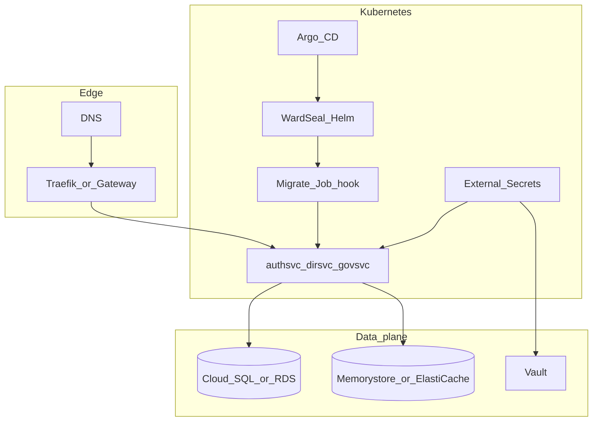

# Cloud prerequisites (before GKE / EKS)

App-layer Helm/Argo/Vault wiring is ready for cloud only after the checklist below. This runbook does **not** provision cloud accounts; it is the gate before Terraform/Autopilot.

## Architecture target

Reuse existing stack:

- Kubernetes (GKE Autopilot recommended for cost, or EKS)
- Helm umbrella chart [`deploy/charts/wardseal`](../charts/wardseal)
- Argo CD apps under [`deploy/argocd`](../argocd)
- HashiCorp Vault + External Secrets Operator
- Traefik ingress (chart `ingressClassName: traefik`) **or** change class/annotations before sync
- Managed Postgres + Redis in the **same namespace DNS** as the release (`wardseal-staging` / `wardseal-production`)



## One-time cluster prerequisites

1. **Cluster** with outbound access to GHCR (`ghcr.io/dhawalhost/*`).
2. **Namespaces**: `wardseal-staging` and/or `wardseal-production`.
3. **GHCR pull secret** named `ghcr-pull-secret` in each namespace:
   ```bash
   kubectl create secret docker-registry ghcr-pull-secret \
     -n wardseal-staging \
     --docker-server=ghcr.io \
     --docker-username=<github-user> \
     --docker-password=<ghcr-pat>
   ```
4. **Traefik** (or update Helm `ingress.className` + annotations for GCE/ALB).
5. **cert-manager** (optional) and use `values-*-certmanager.yaml` overlays.
6. **External Secrets Operator** installed cluster-wide.
7. **Vault** reachable from the cluster; update [`deploy/argocd/external-secrets-*.yaml`](../argocd/external-secrets-staging.yaml) `server` / namespace for your Vault (do not leave `vault.dhawalhost.com` if greenfield).
8. **Bootstrap AppRole secret** `wardseal-vault-approle` in the namespace (role_id + secret_id).

## Data plane

| Component | Staging naming | Notes |
| --- | --- | --- |
| Postgres | Secret `wardseal-db-credentials-*` keys: `host`, `port`, `username`, `password`, `database` | Prefer `sslmode=require` (charts set `DB_SSLMODE=require`) |
| Redis | Service DNS `redis-staging.wardseal-staging.svc...` / `redis-production.wardseal-production.svc...` | Must match chart `REDIS_ADDR` or override values |
| Service auth | Secret `wardseal-service-auth-*` key `token` (+ optional `header`) | Required — pods fatal without it in staging/prod |

## Migrations ConfigMap (required when `migrations.enabled: true`)

```bash
./scripts/create_migrations_configmap.sh wardseal-staging wardseal-migrations
# or
./scripts/create_migrations_configmap.sh wardseal-production wardseal-migrations
```

The Helm pre-install/pre-upgrade Job mounts this ConfigMap and runs `migrate/migrate` against the DB secret.

## Validate app-layer before cloud sync

```bash
make config-lint
# or
bash scripts/validate_env_config.sh
```

Must pass checks for:

- `ENVIRONMENT` staging/production
- `SERVICE_AUTH_TOKEN` secret mounts
- `DB_SSLMODE=require`
- Redis DNS namespaces
- migrate Job helm hooks
- `ghcr-pull-secret` references

## Argo CD

Pick **one** production Application policy (manual vs automated):

- [`deploy/argocd/application-production.yaml`](../argocd/application-production.yaml) — manual sync
- [`deploy/argocd/wardseal-production.yaml`](../argocd/wardseal-production.yaml) — automated

Do not apply both.

## DNS hosts (default chart hosts)

| Env | Hosts |
| --- | --- |
| Staging | `auth-staging`, `api-staging`, `manage-staging`, `id-staging`, `staging.wardseal.com` |
| Production | `auth`, `api`, `manage`, `id`, `wardseal.com` |

Full matrix and frontend `VITE_*` contract: [`URL_HOSTS.md`](URL_HOSTS.md).

Override hosts in values if using your own domain.

## Ready for cloud provision when

- [ ] `make config-lint` green
- [ ] Vault address/policies parameterized for the target cloud
- [ ] GHCR pull secret created
- [ ] Traefik (or alternate ingress) chosen
- [ ] Managed Postgres + Redis planned with matching DNS/secret keys
- [ ] Migrations ConfigMap script run once per namespace
- [ ] Single Argo app policy selected

Then proceed to GKE Autopilot (cost-lean) or EKS Terraform as a separate effort.
